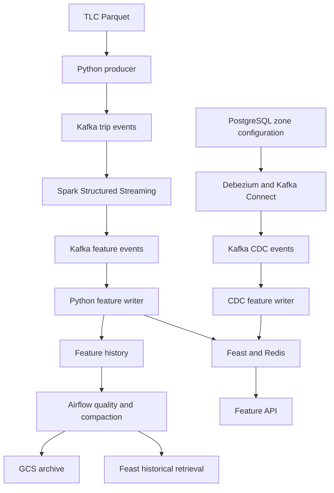

# Real-Time Mobility Feature Platform

A streaming data platform that replays real NYC taxi trip records, computes features for taxi drop-off zones, and serves them through Feast and Redis.

The project explores event ingestion, stream processing, change data capture, historical feature retrieval, orchestration, and observability using Kafka, Spark Structured Streaming, Airflow, and GCP.

> **Status: under development.** The architecture describes the target design. Mark components as implemented only after their acceptance checks pass.

## Use Case

Maintain features describing recently completed trips in each taxi drop-off zone. The initial transformation computes trip duration and fare per mile. Later iterations add windowed trip counts and average fares for forecasting completed trip volume.

A separate CDC branch captures operational zone configuration from PostgreSQL. Feast provides online retrieval for an API and point-in-time historical retrieval for training datasets.

## Architecture

Prometheus collects service metrics. Grafana visualizes Kafka consumer lag, Spark throughput, feature publication latency, CDC status, and API latency.

## Technology Stack

| Component | Responsibility |
|---|---|
| Python | Data preparation, event publishing, feature consumers, and API |
| Kafka | Raw events, feature events, and CDC events |
| Spark Structured Streaming | Validation, transformations, and future windowed aggregations |
| PostgreSQL + Debezium | Capture changes to operational zone configuration |
| Feast + Redis | Feature definitions, online serving, and historical retrieval |
| Airflow | Finite quality, compaction, and archival jobs |
| GCP | GCS archival; future BigQuery and cloud deployment |
| Docker + GitHub Actions | Reproducible environments, checks, and image publication |
| Prometheus + Grafana | Operational metrics and dashboards |

## Data and Time Semantics

- **Trip dataset:** NYC TLC Yellow Taxi records for January 2025.
- **CDC dataset:** synthetic operational zone configuration.
- **Entity:** taxi drop-off zone, identified by `zone_id`.
- **Replay mode:** original trip timestamps are preserved; streaming event timestamps are assigned at publication time.
- **Scale:** report actual processed row counts, source bytes, and throughput after testing.

This is a historical data replay. Windowed features in replay mode describe the simulated stream timeline. Millions of trip events still represent only a few hundred online zone entities.

Source: [NYC TLC Trip Record Data](https://www.nyc.gov/site/tlc/about/tlc-trip-record-data.page)

## Implementation Status

| Capability | Status | Acceptance evidence |
|---|---|---|
| Data preparation and Kafka producer | Planned | Raw events consumed successfully |
| Spark transformations | Planned | Valid features emitted and invalid events separated |
| Feast online serving | Planned | API returns expected features for a known zone |
| Historical retrieval | Planned | Controlled point-in-time retrieval check passes |
| Airflow and GCS archive | Planned | Successful DAG run and archived snapshot |
| GitHub Actions and image publication | Planned | Passing workflow and commit-tagged image |
| PostgreSQL CDC | Planned | Snapshot, update, delete, and restart verified |
| Prometheus and Grafana | Planned | Healthy scrape targets and populated dashboards |
| Windowed transformations | Planned | Boundary and late-event behavior verified |
| GCP deployment | Planned | Cloud replay and recovery checks pass |
| Kubernetes deployment | Planned | Persistent state and restart behavior verified |

## Local Setup

Target environment: Git, Docker Engine or Docker Desktop, Docker Compose, and approximately 6–8 GB of memory available to Docker.

**The startup procedure is being implemented.** Replace this checklist with verified commands as each stage becomes runnable:

1. Clone the repository and copy `.env.example` to `.env`.
2. Build images and start Kafka and Redis.
3. Create topics and prepare a small dataset.
4. Create the initial history snapshot and apply Feast definitions.
5. Start Spark, the feature writer, and the API.
6. Replay a small batch; verify online and historical retrieval.
7. Add Airflow, CDC, and monitoring once their configuration is ready.

Include one working API request and its actual response when serving is implemented.

## Planned Repository Layout

| Path | Contents |
|---|---|
| `src/mobility/` | Producer, Spark job, consumers, API, and instrumentation |
| `feature_repo/` | Feast definitions and store configuration |
| `dags/` | Airflow quality and archival jobs |
| `tests/` | Transformation and retrieval checks |
| `cdc/` | PostgreSQL initialization and Debezium connector configuration |
| `monitoring/` | Prometheus configuration and Grafana provisioning |
| `.github/workflows/` | CI and image publication |
| `docs/` | Setup instructions, benchmarks, recovery procedures, and design decisions |
| `infra/terraform/` | Future GCP infrastructure |
| `k8s/` | Future Kubernetes deployment |

Runtime data, checkpoints, credentials, and local environment files are excluded from Git. Update this layout to match the actual repository.

## Reliability and Validation

Planned checks cover invalid events, Spark checkpoint recovery, consumer restart, duplicate delivery, Redis unavailability, CDC recovery, and historical retrieval with controlled timestamps.

Kafka offsets, local history, and Redis writes do not form one atomic transaction. The project does not currently claim end-to-end exactly-once delivery.

The initial historical table records feature event time. Reconstructing exactly what serving had published at a past instant requires publication history and availability timestamps.

## Benchmarks

No performance results have been measured yet. Record hardware, commit SHA, partition count, test duration, warm-up procedure, and metric definitions with every run.

| Metric | Measured result |
|---|---|
| Input events processed | Pending |
| Sustained input rate | Pending |
| Event-to-online feature latency, p95 | Pending |
| Feature API latency, p95 | Pending |
| Maximum consumer lag | Pending |
| Recovery time after service restart | Pending |
| Cloud cost and test duration | Pending |

## Roadmap

1. Complete the local producer → Kafka → Spark → Feast → API path.
2. Verify historical retrieval, Airflow archival, and container CI.
3. Add PostgreSQL CDC and Prometheus/Grafana.
4. Implement windowed transformations and late-event tests.
5. Run larger replays and document recovery experiments.
6. Deploy to GCP with infrastructure as code.
7. Add a forecasting demo and Kubernetes deployment.

## Current Limitations

The initial deployment uses a single Kafka broker, one Redis instance, local Spark, and Airflow standalone. High availability, authentication, cloud operations, and Kubernetes deployment require further implementation and validation.

## References

- [Feast Workshop](https://github.com/feast-dev/feast-workshop): feature store concepts and integration patterns
- [Data Engineering Zoomcamp](https://github.com/DataTalksClub/data-engineering-zoomcamp): TLC dataset and data engineering patterns
- [MLOps Zoomcamp](https://github.com/DataTalksClub/mlops-zoomcamp): evaluation and deployment practices
- [NYC TLC Trip Record Data](https://www.nyc.gov/site/tlc/about/tlc-trip-record-data.page): trip dataset

Retain upstream license and copyright notices for any copied code.

